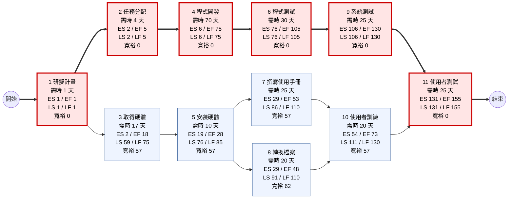
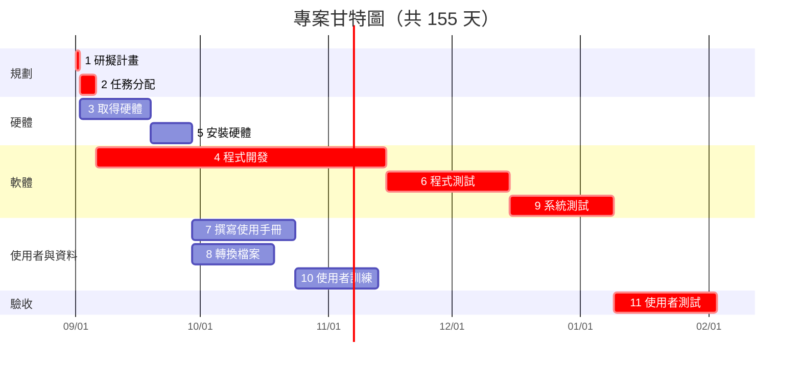

# 個人作業 2：PERT/CPM 圖、甘特圖與關鍵路徑

## 步驟一：顯示任務及任務模式

### 工作分解結構（WBS）— 圖 3-27

| 編號 | 任務說明 | 需時（天） | 前置任務 |
|:---:|---|:---:|:---:|
| 1 | 研擬計畫 (Develop Plan) | 1 | — |
| 2 | 任務分配 (Assign Tasks) | 4 | 1 |
| 3 | 取得硬體 (Obtain Hardware) | 17 | 1 |
| 4 | 程式開發 (Programming) | 70 | 2 |
| 5 | 安裝硬體 (Install Hardware) | 10 | 3 |
| 6 | 程式測試 (Program Test) | 30 | 4 |
| 7 | 撰寫使用手冊 (Write User Manual) | 25 | 5 |
| 8 | 轉換檔案 (Convert Files) | 20 | 5 |
| 9 | 系統測試 (System Test) | 25 | 6 |
| 10 | 使用者訓練 (User Training) | 20 | 7, 8 |
| 11 | 使用者測試 (User Test) | 25 | 9, 10 |

### 任務模式（依存關係）

- **循序任務**：1 → 2 → 4 → 6 → 9；3 → 5
- **並行任務**：任務 1 完成後，任務 2 與 3 可同時進行；任務 5 完成後，任務 7 與 8 可同時進行
- **整合任務（多個前置任務）**：任務 10 需等 7、8 都完成；任務 11 需等 9、10 都完成

---

## 步驟二：輸入開始及結束時間

計算方式：
- **正推（Forward pass）**：最早開始 ES = 所有前置任務最早完成 EF 的最大值 + 1；EF = ES + 需時 − 1
- **逆推（Backward pass）**：最晚完成 LF = 所有後續任務最晚開始 LS 的最小值 − 1；LS = LF − 需時 + 1
- **寬裕時間（Slack）** = LS − ES；寬裕時間為 0 的任務即為關鍵任務

> 以「第 N 天」表示（第 1 天為專案開始日）。日期欄假設專案於 2026-09-01 開始，以日曆天連續計算。

| 編號 | 任務 | 需時 | 最早開始 ES | 最早完成 EF | 最晚開始 LS | 最晚完成 LF | 寬裕 | 開始日期 | 結束日期 | 關鍵？ |
|:---:|---|:---:|:---:|:---:|:---:|:---:|:---:|:---:|:---:|:---:|
| 1 | 研擬計畫 | 1 | 1 | 1 | 1 | 1 | 0 | 2026-09-01 | 2026-09-01 | ✅ |
| 2 | 任務分配 | 4 | 2 | 5 | 2 | 5 | 0 | 2026-09-02 | 2026-09-05 | ✅ |
| 3 | 取得硬體 | 17 | 2 | 18 | 59 | 75 | 57 | 2026-09-02 | 2026-09-18 | |
| 4 | 程式開發 | 70 | 6 | 75 | 6 | 75 | 0 | 2026-09-06 | 2026-11-14 | ✅ |
| 5 | 安裝硬體 | 10 | 19 | 28 | 76 | 85 | 57 | 2026-09-19 | 2026-09-28 | |
| 6 | 程式測試 | 30 | 76 | 105 | 76 | 105 | 0 | 2026-11-15 | 2026-12-14 | ✅ |
| 7 | 撰寫使用手冊 | 25 | 29 | 53 | 86 | 110 | 57 | 2026-09-29 | 2026-10-23 | |
| 8 | 轉換檔案 | 20 | 29 | 48 | 91 | 110 | 62 | 2026-09-29 | 2026-10-18 | |
| 9 | 系統測試 | 25 | 106 | 130 | 106 | 130 | 0 | 2026-12-15 | 2027-01-08 | ✅ |
| 10 | 使用者訓練 | 20 | 54 | 73 | 111 | 130 | 57 | 2026-10-24 | 2026-11-12 | |
| 11 | 使用者測試 | 25 | 131 | 155 | 131 | 155 | 0 | 2027-01-09 | 2027-02-02 | ✅ |

**專案總工期：155 天**

---

## (1) PERT/CPM 圖

紅框與粗箭頭為關鍵路徑。每個節點顯示：需時、ES/EF（最早開始／完成）、LS/LF（最晚開始／完成）、寬裕時間。

---

## (2) 甘特圖

紅色長條為關鍵任務（假設 2026-09-01 開工，以日曆天計算）。

---

## (3) 關鍵路徑

**關鍵路徑：任務 1 → 2 → 4 → 6 → 9 → 11**

| 任務 | 1 研擬計畫 | 2 任務分配 | 4 程式開發 | 6 程式測試 | 9 系統測試 | 11 使用者測試 | 合計 |
|---|:---:|:---:|:---:|:---:|:---:|:---:|:---:|
| 需時（天） | 1 | 4 | 70 | 30 | 25 | 25 | **155** |

### 各路徑比較

| 路徑 | 計算 | 總天數 |
|---|---|:---:|
| **1 → 2 → 4 → 6 → 9 → 11** | 1 + 4 + 70 + 30 + 25 + 25 | **155（最長，關鍵路徑）** |
| 1 → 3 → 5 → 7 → 10 → 11 | 1 + 17 + 10 + 25 + 20 + 25 | 98 |
| 1 → 3 → 5 → 8 → 10 → 11 | 1 + 17 + 10 + 20 + 20 + 25 | 93 |

### 說明

- 關鍵路徑是從開始到結束**需時最長**的路徑，決定了專案最短完成時間（155 天）。
- 關鍵路徑上的任務寬裕時間皆為 0，**任何一項延誤都會直接造成整個專案延誤**。
- 非關鍵任務有寬裕時間可彈性調度：任務 3、5、7、10 各有 57 天，任務 8 有 62 天。
- 專案經理應優先監控程式開發（70 天）與程式測試（30 天）等關鍵任務；若需縮短工期，應投入資源於關鍵路徑上的任務。
